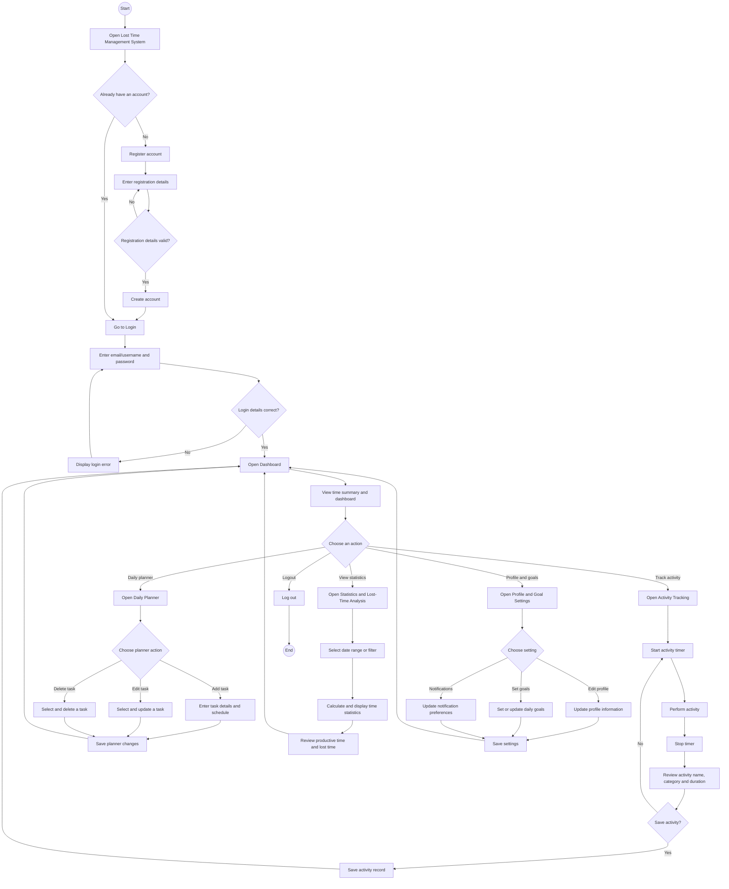

# Lost Time Management System — Activity Diagram

This activity diagram represents the main workflow of the Lost Time Management System, including account management, dashboard, activity tracking, daily planner, statistics and lost-time analysis, and profile and goal settings.

## Main workflow explanation

1. **Start and account access:** The user opens the application, registers if they do not have an account, and logs in.
2. **Dashboard:** After successful login, the system displays the user's time summary and available modules.
3. **Activity tracking:** The user starts and stops a timer, reviews the activity details, and saves the activity record.
4. **Daily planner:** The user can add, edit, or delete tasks and save the changes.
5. **Statistics and lost-time analysis:** The system calculates and displays time statistics for the selected date range.
6. **Profile and goal settings:** The user can update profile information, daily goals, and notification preferences.
7. **Logout:** The user logs out and the workflow ends.

## GitHub upload

Recommended location in your repository:

`docs/diagrams/Activity_Diagram.md`

GitHub supports Mermaid diagrams in Markdown files. Open this file in your repository to view the rendered diagram.
